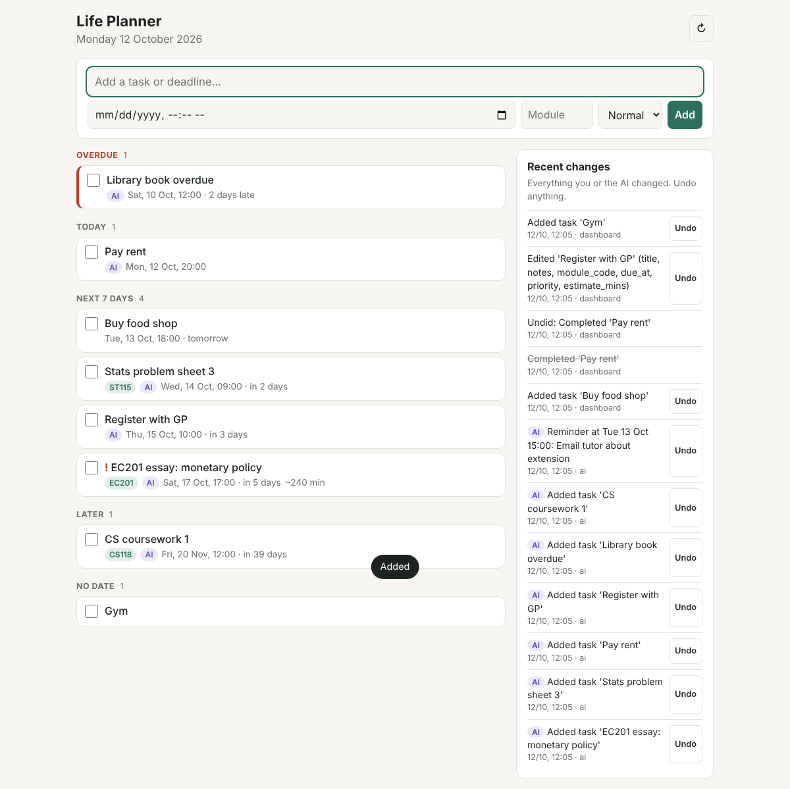

# Life Planner

A self-hosted planner for uni and everyday life. You talk to an AI agent (Claude, through MCP) to add and plan
things; the website is a dashboard; your phone gets push notifications for anything due.



See [`docs/CONCEPT.md`](../docs/CONCEPT.md) for the full idea and roadmap. **Status: phase 2 of 5 (tasks and deadlines).**

## How it fits together

```
Claude app ──MCP (/mcp)──┐
Dashboard ───REST (/api)─┼──> app/services ──> SQLite (data/planner.db)
Scheduler (every minute)─┘          └──> ntfy ──> phone notification
```

- `app/services/` is the only code that changes data. `app/api/routes.py` (dashboard) and `app/mcp_server.py`
  (AI) are thin wrappers, so both always behave the same.
- Every change goes in an activity log with who made it (`ai` / `dashboard`) and a before/after snapshot,
  so anything can be undone from the dashboard or by asking Claude.
- Times: stored as UTC, accepted and shown as UK time (`app/timeutil.py`). A time without an offset,
  e.g. `2026-10-17T17:00`, is read as UK time, BST or GMT as appropriate.

## Run it locally

```bash
cd life-planner
python -m venv .venv && source .venv/bin/activate   # Windows: .venv\Scripts\activate
pip install -r requirements-dev.txt
uvicorn app.main:app --reload
```

Then open http://localhost:8000 (dashboard) or http://localhost:8000/docs (interactive API docs).
Run the tests with `pytest`.

## Notifications (ntfy)

1. Install the **ntfy** app (Android/iOS) and subscribe to a long random topic name.
2. Put the same name in `.env` as `NTFY_TOPIC`.

You get a push 24 h and 2 h before each deadline (change this with `REMINDER_OFFSETS_HOURS`), any one-off
reminders Claude sets, and a morning digest at `DIGEST_TIME`. Without `NTFY_TOPIC` they're only logged.

## Talk to it from Claude

**Locally (Claude Desktop / Claude Code):** add an MCP server with the URL `http://localhost:8000/mcp`.
Test the tools first with `npx @modelcontextprotocol/inspector`.

**From your phone:** the Claude app needs a public HTTPS URL, which is what the deploy steps below give you.
Add a custom connector pointing at `https://<your-host>/mcp`.

> Auth caveat: when `PLANNER_TOKEN` is set, `/api` and `/mcp` require it as `Authorization: Bearer <token>`
> or `?token=<token>`. I'm not certain which auth methods Claude custom connectors currently accept. If
> a token in the URL works, use `https://<host>/mcp?token=...`. If connectors require OAuth, that is
> the next piece to build (the MCP SDK has OAuth support). Check the current connector docs first.

Things to try: *"Add my EC201 essay, due Friday 5pm, high priority, about 4 hours"*,
*"What's overdue?"*, *"Remind me at 3pm to email my tutor"*, *"Undo that last change"*.

## Deploy at home (Raspberry Pi or old laptop)

1. Install Docker, copy this folder over, then `cp .env.example .env` and fill it in (set `PLANNER_TOKEN`!).
2. `docker compose up -d` gives you the dashboard at `http://<pi-ip>:8000` on your home Wi-Fi.
3. To use it away from home and from the Claude app, create a free **Cloudflare Tunnel** (Zero Trust
   dashboard → Networks → Tunnels) that points a hostname at `http://planner:8000`. Then put its token in
   `TUNNEL_TOKEN`, the hostname in `PUBLIC_HOSTS`, and run `docker compose --profile tunnel up -d`.
4. Protect the dashboard with **Cloudflare Access** (free; one-time email code). Exclude `/mcp` from Access,
   since Claude can't do the email login; `/mcp` relies on `PLANNER_TOKEN` instead.
5. Back up `data/planner.db` (e.g. a nightly cron job copying it to cloud storage).
6. On your phone, open the dashboard and use "Add to Home Screen" to install it like an app.

## Layout

```
app/
  main.py          app factory: /api, /mcp, dashboard, token check
  config.py        settings from environment variables
  timeutil.py      UTC <-> UK time
  models.py        Task, Reminder, ActivityLog tables
  db.py            engine + sessions
  services/        tasks, reminders, activity (undo), serialise
  api/routes.py    REST endpoints for the dashboard
  mcp_server.py    MCP tools for the AI
  scheduler.py     reminder + digest jobs
  notify.py        ntfy client
web/               dashboard (vanilla HTML/CSS/JS, installable PWA)
tests/             pytest
```
